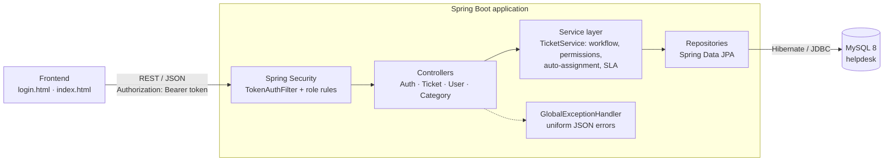
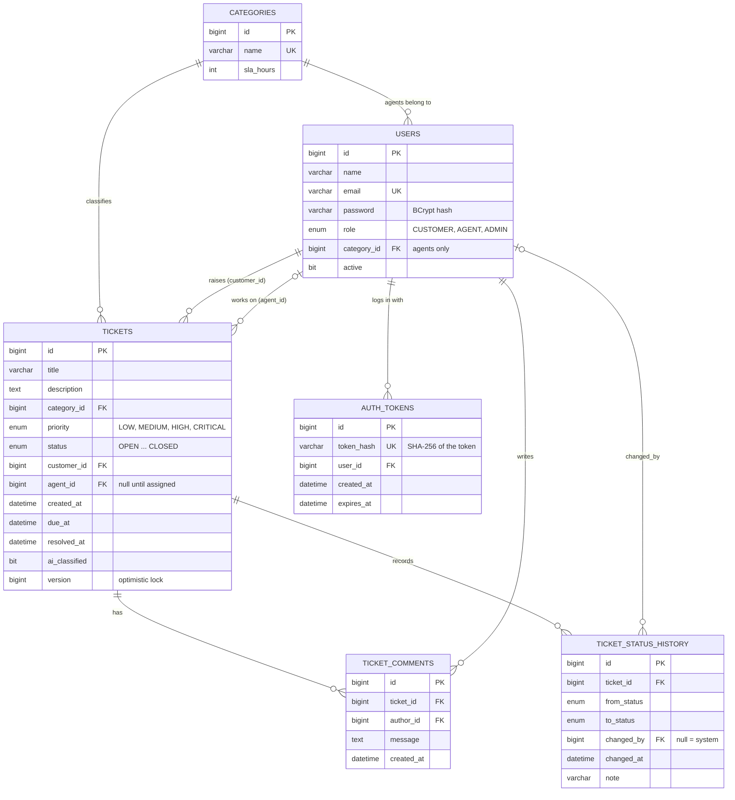
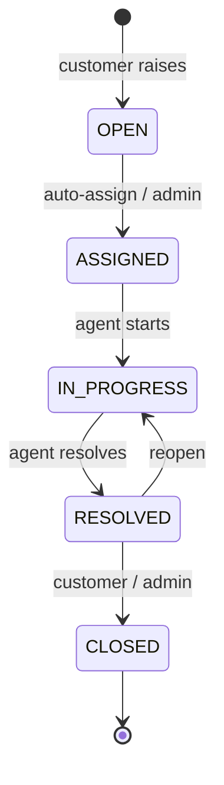

# Helpdesk – Customer Support Ticket System

**CODESPARK HACKATHON 2026 · Problem Statement 42 (AI + Information Systems)**

A support platform where customers sign up and raise tickets, the system routes each ticket to the least busy agent in the right category, agents work through a controlled status workflow, and admins track SLA breaches.

**Stack:** Java 21 · Spring Boot 4.1.2 · Spring Data JPA / Hibernate · MySQL 8 · Spring Security (BCrypt + token authentication) · HTML/JavaScript frontend

---

## 1. How to run

1. Install Java 21 and MySQL 8, and make sure the MySQL service is running.
2. Copy `.env.example` to `.env` and set `DB_PASSWORD` to your MySQL root password. The `helpdesk` database is created automatically.
3. Start the app from the project folder:
   - Windows PowerShell: `.\mvnw spring-boot:run`
   - macOS / Linux: `./mvnw spring-boot:run`
4. Open **http://localhost:8080**. You will be sent to the login page; log in with a demo account or sign up as a new customer.

On first start the app creates all tables and loads demo data: 5 categories, 10 users and 6 tickets.

### Demo users (password for all: `password123`)

| ID | Name | Role | Category |
|---|---|---|---|
| 1 | Admin | ADMIN | – |
| 2 | Ravi | AGENT | Billing |
| 3 | Sneha | AGENT | Billing |
| 4 | Arjun | AGENT | Technical |
| 5 | Priya | AGENT | Technical |
| 6 | Kiran | AGENT | Account |
| 7 | Meena | AGENT | Delivery |
| 8 | Vikram | AGENT | General |
| 9 | Anil | CUSTOMER | – |
| 10 | Divya | CUSTOMER | – |

---

## 2. System architecture



- **Spring Security** checks the login token on every request and blocks whole areas by role (for example, only admins can reassign).
- **Controllers** only receive requests and return DTOs.
- **TicketService** holds every business rule, so the rules apply no matter which client calls the API.
- **Entities never leave the server.** Responses are DTOs, so password hashes can never leak.

---

## 3. Database design (ER diagram)



**Design decisions**
- One `users` table for all roles keeps identity in one place. `tickets` references it twice: `customer_id` and `agent_id`.
- `ticket_status_history` is an audit table: every status change is a row, so the full lifecycle of a ticket can be shown.
- Indexes: `status`, `(agent_id, status)` for the workload query, and `due_at` for the SLA query. Unique constraints on `users.email` and `categories.name`.
- `version` column with JPA `@Version` gives optimistic locking.
- `auth_tokens` stores only a SHA-256 hash of each login token, so a leaked database cannot be used to log in.

A diagram of the live database can also be generated in MySQL Workbench: **Database → Reverse Engineer → helpdesk**.

---

## 4. API endpoints

Log in first, then send the token on every call: `Authorization: Bearer <token>`. Errors always return JSON: `{timestamp, status, error, message, fieldErrors}`.

| Method | Endpoint | Allowed for | Purpose |
|---|---|---|---|
| POST | `/api/auth/register` | anyone | Sign up as a customer; returns a token |
| POST | `/api/auth/login` | anyone | Log in; returns a token valid for 8 hours |
| POST | `/api/auth/logout` | logged in | Delete the token |
| GET | `/api/auth/me` | logged in | The current user |
| GET | `/api/categories` | anyone | List categories with SLA hours |
| POST | `/api/categories` | admin | Add a category (validated) |
| GET | `/api/users?role=AGENT` | admin | List users (no passwords) |
| POST | `/api/tickets` | customer | Raise a ticket; it is auto-assigned |
| GET | `/api/tickets?status=OPEN` | all roles | Customer: own · Agent: assigned · Admin: all |
| GET | `/api/tickets/{id}` | owner, assigned agent, admin | Ticket with comments and history |
| PATCH | `/api/tickets/{id}/status` | see rules below | Move a ticket through the workflow |
| POST | `/api/tickets/{id}/comments` | owner, assigned agent, admin | Add a comment |
| PUT | `/api/tickets/{id}/assign` | admin | Reassign: `{"agentId":3}` or `{"agentId":null}` for auto |
| GET | `/api/tickets/sla-breaches` | admin | Open tickets past their due time |

Example – log in, then raise a ticket:
```http
POST /api/auth/login
Content-Type: application/json

{"email": "anil@gmail.com", "password": "password123"}
```
```http
POST /api/tickets
Authorization: Bearer <token from login>
Content-Type: application/json

{"title": "Charged twice", "description": "My card was charged two times for one order.", "categoryId": 1, "priority": "HIGH"}
```

| Status code | Meaning |
|---|---|
| 200 / 201 | Success |
| 400 | Validation failed or invalid status change |
| 401 | Not logged in, token expired, or wrong email/password |
| 403 | The user's role is not allowed to do this |
| 404 | Ticket, user or category not found |
| 409 | Someone else updated the ticket at the same time |

---

## 5. Business rules

**Workflow**



- **Auto-assignment:** a single JPQL query finds every active agent in the ticket's category with a count of their ASSIGNED and IN_PROGRESS tickets (LEFT JOIN, so agents with zero tickets count too). The agent with the lowest count gets the ticket.
- **SLA:** due time = category SLA hours × priority factor (LOW 1.5, MEDIUM 1.0, HIGH 0.5, CRITICAL 0.25). Example: a HIGH Billing ticket is due in 12 × 0.5 = 6 hours.
- **Permissions:** agents can update only tickets assigned to them and cannot close them; customers can only close or reopen their own resolved tickets; admins can make any valid move and reassign.
- **Authentication:** passwords are BCrypt hashes. Login creates a random 256-bit token that expires after 8 hours; the server keeps only its SHA-256 hash. Sign-up always creates a CUSTOMER account, so nobody can make themselves an agent or admin. Login errors never reveal whether an email exists.
- **Two layers of authorization:** Spring Security URL rules block whole areas by role, and TicketService checks per-ticket rules (an agent can only touch tickets assigned to them).
- **Validation:** title required (max 150), description 10–2000 characters, comment required. Invalid input returns 400 with a message for each field.

---

## 6. Demo script (5 minutes)

1. **Sign up** a new customer on the login page. Show that a short password or a duplicate email is rejected with a clear message.
2. **As that customer,** raise "Charged twice for my order" in Billing with HIGH priority. It is instantly assigned to the least busy Billing agent with a 6-hour SLA. Log out.
3. **Log in as that Billing agent** (ravi@helpdesk.com or sneha@helpdesk.com). Open the ticket, click **Start work**, add a comment, then **Resolve**. Try **Close**: the server refuses, because agents cannot close tickets. Log out.
4. **Log back in as the customer** and click **Close**.
5. **Log in as Admin:** view all tickets, click **SLA breaches** to see overdue tickets, and reassign one.
6. **MySQL Workbench:** show `SELECT * FROM ticket_status_history;` for the audit trail, and `SELECT * FROM users;` / `SELECT * FROM auth_tokens;` to prove passwords and tokens are stored only as hashes.

## 7. Project structure

```
src/main/java/com/codespark/helpdesk
├── config/        SecurityConfig (URL rules, BCrypt), DataSeeder (demo data)
├── controller/    REST endpoints
├── dto/           Request/response records (validation lives here)
├── exception/     Custom exceptions + GlobalExceptionHandler
├── model/         JPA entities and enums
├── repository/    Spring Data JPA repositories + workload projection
├── security/      TokenAuthFilter (reads the Bearer token), TokenHasher
└── service/       TicketService (business rules), AuthService (sign-up, login, tokens)
src/main/resources
├── application.properties
└── static/        login.html (log in / sign up) and index.html (the app)
```

## 8. Future improvements
- Admin screen to create agent accounts and deactivate users.
- Python NLP service to classify the category and predict priority from the ticket text.
- Admin dashboard with charts (tickets by status, average resolution time per agent).
